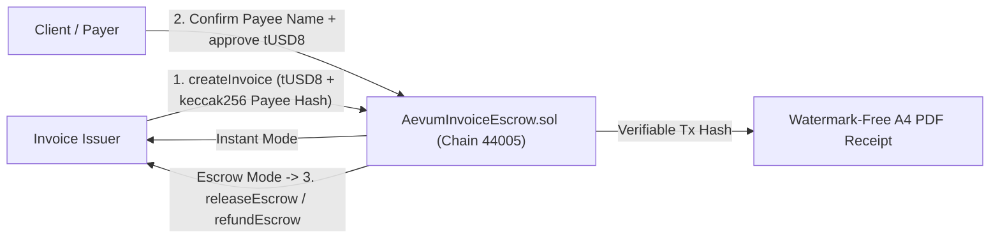

# AevumPay — Trustless `tUSD8` Invoice Payments & Confirmation-of-Payee Escrow

Built for **Aevum Builder Challenge #1 (DoraHacks)** on the **QDay Aevum Testnet (Chain ID `44005`)**.

- **Live Web3 App**: https://devbox-zero-ops.github.io/aevumpay/
- **Network**: QDay Aevum Testnet (`Chain ID: 44005 / 0xabe5`, RPC: `https://rpc-test.qday.info`)
- **Settlement Token**: `tUSD8` (`0x456569838f1d43009A91ebA4263147Afd7233483`, 6 decimals)
- **Explorer**: https://explorer-test.qday.info

## Problem Solved
Freelancers, agencies, and B2B contractors settling invoices in stablecoins face two recurring operational risks:
1. **Wrong-Recipient Transfers**: Copy-pasting an EVM address offers zero name verification.
2. **Delivery vs. Payment Trust Gap**: Payers hesitate to prepay 100%, while freelancers risk non-payment after delivery.

## Architecture & Key Features


- **On-Chain Confirmation of Payee**: Every invoice commits `keccak256(normalizedPayeeName)`. `payInvoice()` reverts with `PAYEE_MISMATCH` unless the payer explicitly confirms the matching legal/studio name.
- **Dual Settlement Modes**: Supports both instant `tUSD8` settlement and trustless milestone escrow (`releaseEscrow` by payer, voluntary `refundEscrow` by issuer, `cancelInvoice` before payment).
- **Reentrancy-Guarded Solidity 0.8.20**: Compiled cleanly with `solc 0.8.20` (optimizer 200 runs, 0 warnings); ABI & bytecode committed under `artifacts/AevumInvoiceEscrow.json`.
- **Zero-Backend Client-Side UI**: Auto-adds QDay Aevum Testnet (`44005`) to MetaMask/Rabby, reads live block height & `tUSD8` balance directly from `https://rpc-test.qday.info`, supports one-click contract deployment, and prints clean A4 PDF on-chain receipts.

## Local Build & Verification
```bash
npm install
node scripts_compile.mjs
```
